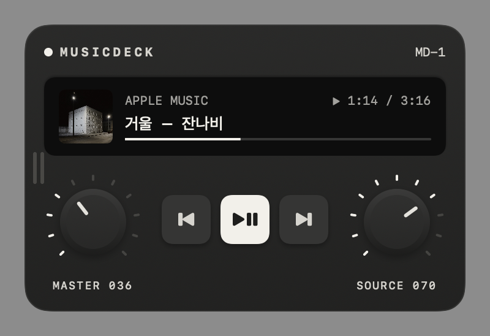
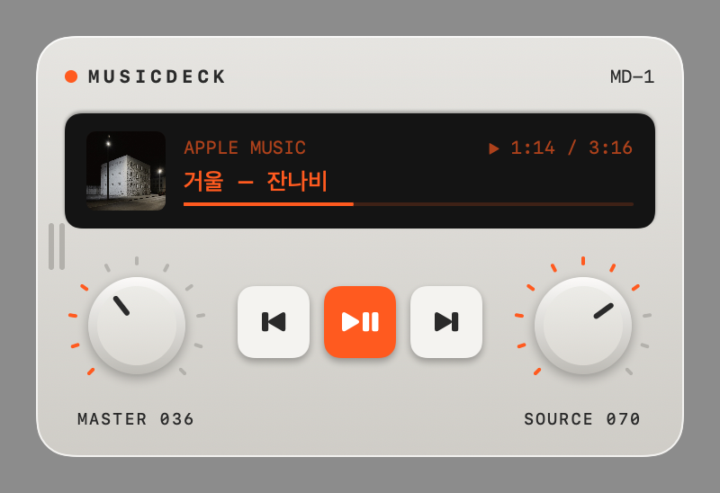

# MusicDeck

바탕화면에 놓이는 작은 음악 기기. 지금 노래가 어디서 나오는지(크롬·사파리의 유튜브 탭, 애플뮤직) 보여주고, 다이얼과 버튼으로 바로 조작한다.

<p>
  
  
</p>

## 기능

- **재생 출처 표시** — 곡 제목, 유튜브 썸네일·앨범 커버, 재생 시간과 진행 막대. 화면을 누르면 그 탭이나 앱으로 이동한다.
- **다이얼 두 개** — 왼쪽은 맥 전체 볼륨, 오른쪽은 노래 볼륨(유튜브 플레이어 / 애플뮤직 볼륨). 원을 그리며 돌리거나 포인터를 올리고 스크롤한다. 한 칸마다 딸깍 소리와 트랙패드 진동.
- **이전 곡 · 재생/멈춤 · 다음 곡**
- **소스 고르기** — 여러 곳에서 틀어두면 `SOURCES`를 펼쳐 고른다. 고른 곳을 재생하고 나머지는 멈춘다.
- **화면 끝에 숨기기** — 화면 왼쪽·오른쪽·위쪽 끝 밖으로 밀면 숨고, 남은 손잡이를 누르면 나온다.
- **테마** — 라이트 / 무광 블랙 (우클릭 메뉴)

## 요구 사항

- macOS 15 이상
- 유튜브를 쓰려면 브라우저에서 **Apple Events의 JavaScript 허용**을 켠다.
  - 사파리: 설정 › 고급 › "메뉴 막대에서 개발자용 메뉴 보기" → 개발자용 메뉴 › "Apple Events의 JavaScript 허용"
  - 크롬: 보기 › 개발자 › "Apple Events의 JavaScript 허용"

macOS 15.4부터 시스템의 "지금 재생 중" 정보는 다른 앱이 읽을 수 없어서, 크롬·사파리·애플뮤직에 AppleScript로 직접 묻는 방식이다.

## 빌드

```bash
./build.sh && open MusicDeck.app
```

Swift Package Manager로 빌드하고 `MusicDeck.app`으로 묶는다(애드혹 서명). 처음 실행하면 Safari·Music 제어 허용 창이 뜬다.
